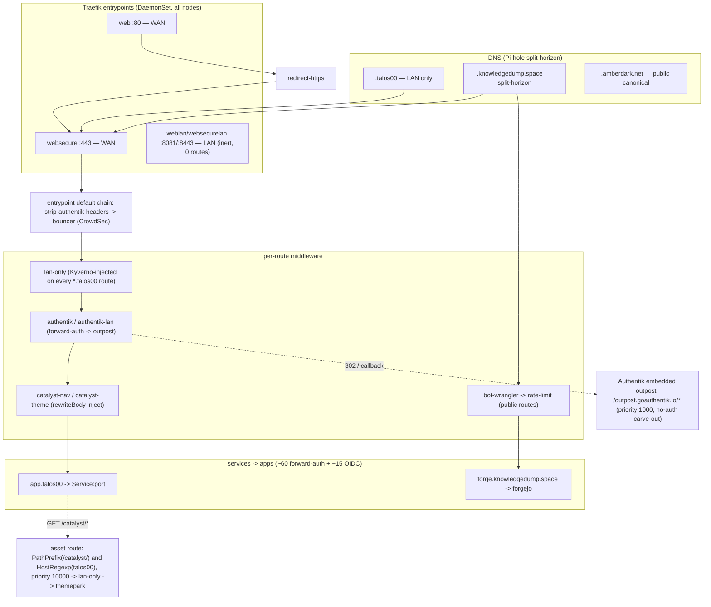

# Routing & Auth Topology

## TL;DR

How a request reaches an app, and how SSO is enforced, after the 2026-10-24 routing cleanup
(the `.priv.*` legacy redirect layers were retired and a single Kyverno policy now defaults
`lan-only` onto every internal route).

- **DNS** is Pi-hole split-horizon: `*.talos00` = LAN-only, `*.knowledgedump.space` = split
  (LAN bypasses Cloudflare), `*.amberdark.net` = public canonical.
- **Traefik** (DaemonSet on all nodes) has two WAN entrypoints (`web`:80 / `websecure`:443) and
  two inert LAN entrypoints (`weblan`:8081 / `websecurelan`:8443, 0 routes — superseded).
- Every request first hits the entrypoint-default chain **`strip-authentik-headers → bouncer`**
  (header-spoof defense + CrowdSec), then per-route middleware.
- **Internal gating** is `lan-only` (Kyverno-injected on every `*.talos00` route). **SSO** is
  either forward-auth (the `authentik` middleware → embedded outpost, ~60 apps) or native OIDC
  (the app runs its own client against authentik, ~15 apps).
- Live counts (2026-10-24): **231 IngressRoutes, ~70 nav-enabled apps, 23 CNPG databases.**

See the [flow diagram](#the-flow) below, or the standalone
[`infrastructure/base/traefik/routing-flow.mmd`](../../infrastructure/base/traefik/routing-flow.mmd).

---

## The flow

---

## Routing layer (reference)

### Entrypoints — `infrastructure/base/traefik/helmrelease.yaml`

Traefik runs as a **DaemonSet** binding hostPorts on every node; the Service is a `LoadBalancer`.
The `--entrypoints.<ep>.http.middlewares=` CLI flags are authoritative (override chart `ports`).

| Entrypoint | Port | On LB Service? | Default chain | Reach |
|---|---|---|---|---|
| `web` | 80 | yes | `strip-authentik-headers → bouncer` | WAN |
| `websecure` | 443 | yes | `strip-authentik-headers → bouncer` | WAN |
| `weblan` | 8081 | no (hostPort only) | `… → lan-only` | LAN **(inert — 0 routes)** |
| `websecurelan` | 8443 | no (hostPort only) | `… → lan-only` | LAN **(inert — 0 routes)** |
| `bolt` | 7687 | yes | none (raw Bolt TCP) | Neo4j Browser |

- `strip-authentik-headers` runs **first on every entrypoint** so a client cannot forge
  `X-authentik-*` identity headers; the outpost re-injects the real values on gated routes.
- `forwardedHeaders.trustedIPs` is **Cloudflare ranges only** — `10.0.0.0/8` was removed so pods
  can't forge `X-Forwarded-For`.
- `weblan`/`websecurelan` were the P0-4 dedicated-LAN-entrypoint design; **0 routes ever migrated**
  (the VIP never exposed :8443, so `https://x.talos00` would break for LAN browsers). Superseded by
  the per-route `lan-only` Kyverno policy. Candidates for removal.

### Middleware catalog

`infrastructure/base/traefik/middlewares.yaml`:

| Middleware | Does |
|---|---|
| `lan-only` | ipAllowList RFC1918 (`10/8` + `172.16/12` + `192.168/16` + loopback) — admits pods+LAN, blocks WAN |
| `lan-only-strict` | `192.168/16` + loopback only (excludes pod/service CIDRs) |
| `redirect-https` | 301 http→https (the `*-http` companion routes) |
| `security-headers` | HSTS 1yr+preload, nosniff, `X-Frame-Options: SAMEORIGIN`, referrer-policy |
| `bot-wrangler` | serves `/robots.txt`; PROXYs LLM-scraper UAs into the `iocaine` tarpit (public routes) |
| `strip-authentik-headers` | clears inbound client `X-Authentik-*` request headers (entrypoint-default) |
| `private-domain-redirect` | 302 `*.priv.talos00` → `*.amberdark.net` (remaining amber redirectors) |
| `forge-canonical-redirect` | 302 `forge.talos00` → `forge.knowledgedump.space` |
| `rate-limit` | token bucket 100 r/s avg, burst 200, per real client IP (public routes) |
| `request-body-limit` | 8 GiB body cap (zipline uploads) |

`infrastructure/base/authentik/middleware.yaml` + `authentik-lan-outpost/middleware.yaml`:

| Middleware | Does |
|---|---|
| `authentik` | forwardAuth → embedded outpost `/outpost.goauthentik.io/auth/traefik`; advertises `auth.knowledgedump.space`; re-injects 11 `X-authentik-*` headers |
| `authentik-lan` | same, but → `talos00-outpost:9000`, advertises `auth.talos00`. **Inert** (staged cutover, TALOS-22nn) |

### Kyverno route policies — `infrastructure/base/kyverno-policies/`

| Policy | Type | Effect |
|---|---|---|
| `ingressroute-tls-default` | mutate (add-if-absent) | injects `tls: {}` on any `websecure` route lacking it (JSON6902 `add`; the `+(tls):{}` SMP anchor is a silent no-op) |
| `ingressroute-no-combined-entrypoints` | validate/Enforce | denies web+websecure on one router; **CREATE/UPDATE only** so grandfathered routes stay deletable |
| `ingressroute-lan-only-talos00` | mutate (prepend-if-absent) | prepends `lan-only` on every literal `Host(*.talos00)` route; the **HostRegexp exclusion** is the landmine-guard protecting the shared outpost callback |
| `restrict-public-hostname-claims` | validate/Enforce | only `media-private`/`authentik` namespaces may claim `*.amberdark.net` |

### Theme / nav injection — `infrastructure/base/themepark/`

- **Contract:** ONE `catalyst-*` middleware per route serving HTML. `catalyst-<slug>` = full theme +
  nav (apps with a base sheet, or dbgate/argocd hand-authored); `catalyst-nav` = cross-app bar only.
- **Chain:** `catalyst-compress → catalyst-accept-encoding → catalyst-inject-<slug>` (ONE
  `rewriteBody` per chain — chaining two body-rewriters is a silent no-op).
- **Asset route** (`asset-route.yaml`): one cluster-wide route publishes `/catalyst/` on every host
  via `PathPrefix(/catalyst/) && HostRegexp(^[a-z0-9-]+\.talos00$)` at priority 10000, gated by the
  two-control pattern (`HostRegexp` + `lan-only` — each closes the other's bypass; follows a
  confirmed past disclosure of `catalyst-nav.json` via the public forge host).
- **`server/nav/build_nav.py`** derives the nav bar from IngressRoute annotations
  (`gethomepage.dev/enabled` gate; `name`/`group`/`weight`; middleware-name classification for
  injected/themed). This is the prior art the `system-graph` epic reuses.

### DNS — `infrastructure/base/pihole/statefulset.yaml`

Split-horizon wildcards (`FTLCONF_misc_dnsmasq_lines`), longest-match overrides punch holes:

| Zone | LAN resolution | WAN | TLS |
|---|---|---|---|
| `*.talos00` / `*.priv.talos00` | Pi-hole wildcard → Traefik node IP | none (+ Kyverno `lan-only` 403s Host-spoof) | homelab-CA wildcards |
| `*.knowledgedump.space` | Pi-hole wildcard → Traefik (bypasses Cloudflare) | real Cloudflare (proxied true/false) | Let's Encrypt (default cert) |
| `*.amberdark.net` | Pi-hole wildcard → Traefik; `outpost.amberdark.net` → external IP | public | LE `*.amberdark.net` |

`cloudflare-proxied: false` (grey-cloud) is used where uploads exceed Cloudflare's 100 MB cap
(forge, registry).

---

## Authentik layer (reference)

### Auth hostnames — `infrastructure/base/authentik/ingressroute.yaml`

| Host | Purpose |
|---|---|
| `auth.talos00` (web + websecure) | LAN login |
| `auth.knowledgedump.space` | public login (rate-limited); the embedded outpost advertises this |
| `authentik-outpost-priv` (HostRegexp, priority 1000) | shared forward-auth callback for every `*.talos00` app's `/outpost.goauthentik.io/*` — no auth middleware, served by the embedded outpost |

`auth.priv.talos00` and `auth.priv.knowledgedump.space` were **retired 2026-10-24** (0 live routes).

### Forward-auth flow

1. Browser hits `https://<app>.talos00/<path>`; entrypoint default strips client `X-authentik-*`.
2. The app's `Host(<app>.talos00)` route matches; it carries `middlewares: [authentik]`.
3. `authentik` issues a forward-auth subrequest to the embedded outpost's `/auth/traefik`.
4. No session → 302 to `/outpost.goauthentik.io/start`, caught by `authentik-outpost-priv`
   (priority 1000, no auth) → outpost redirects to the `auth.knowledgedump.space` login flow.
5. Callback lands on `<app>.talos00/outpost.goauthentik.io/callback` (same priority-1000 route) →
   session cookie set.
6. Retried request passes; the outpost returns `X-authentik-*` identity headers, copied upstream.

Native-OIDC apps bypass all of this — they run their own OIDC client against authentik's OAuth2
endpoints with a confidential `client_id`/`client_secret`.

### Providers

- **~60 forward-auth proxy providers** (`external_host: https://<app>.talos00`), bound to the
  embedded outpost. Authoritative list: the `!Find` block in
  `authentik/talos00-outpost-blueprint.yaml` + the binding block in `talos-private-blueprint.yaml`.
  Grouped by blueprint: arr-stack, infra-admin, home, media-experimental, sister-apps, homepage
  (8 dashboards), gap-apps, talos-private (kubeview/headlamp/guacamole/windows-vnc — the last three
  moved from `.priv.talos00` to `.talos00` on 2026-10-24), + single-app blueprints.
- **~15 native-OIDC (OAuth2) providers**: argocd, grafana, forgejo, litellm, zipline, minio, zot,
  boomtime, manyfold, linkwarden, immich, audiobookshelf, komga, kavita, bookorbit.

### Outposts

1. **Embedded** — in-process in `authentik-server` (2 replicas); holds all ~60 proxy providers +
   the OIDC providers; its auto-generated k8s Ingress is disabled (caused ~1,570 TLS errors/hr).
2. **`talos00-outpost`** (TALOS-22nn) — staged dedicated LAN outpost, **inert** (nothing routes to
   it until a per-app cutover: middleware `authentik`→`authentik-lan` + a priority-2000 callback).
3. **amberdark-outpost** — the working precedent, in the external `talos-private` repo.

### Blueprint delivery

Each `*-blueprint.yaml` is a configMapGenerator ConfigMap mounted to
`/blueprints/mounted/cm-<name>/` on the **worker** (directory mounts, not subPath — kubelet
propagates updates; the worker re-applies on file change). ConfigMaps are explicitly listed under
`helmrelease.yaml` `blueprints.configMaps:` (no label auto-discovery). `!Env` client secrets come
from ESO-populated worker env, each `optional: true` so a missing secret can't CrashLoop SSO.

---

## Audit findings (open — see Related Issues)

1. **Orphaned immich OIDC provider.** The immich *workload* was retired 2026-10-24, but
   `authentik/immich-blueprint.yaml` is still present (`kustomization.yaml:23`,
   `helmrelease.yaml:79`) — a native-OIDC provider now points at a dead app. Cleanup bead filed.
2. **`strip-authentik-headers` gap (`TALOS-a8vo.10`).** The strip set misses
   `X-authentik-entitlements` and `ApiKey`; both still client-forgeable. Pre-existing.
3. **Dead LAN entrypoints.** `weblan`/`websecurelan` carry 0 routes and are superseded by the
   per-route `lan-only` policy; candidates for removal from `helmrelease.yaml`.

---

## Related Issues

<!-- Beads tracking for this doc -->
- TALOS-a8vo — ingress/network accessibility audit (host-spoof remediation; the `lan-only` policy)
- TALOS-22nn — the staged `talos00-outpost` LAN cutover
- TALOS-gsgh — `system-graph` epic: the live topology-graph web UI that consumes this annotation model
- TALOS-4d2p — remove the orphaned immich OIDC provider (finding #1)
